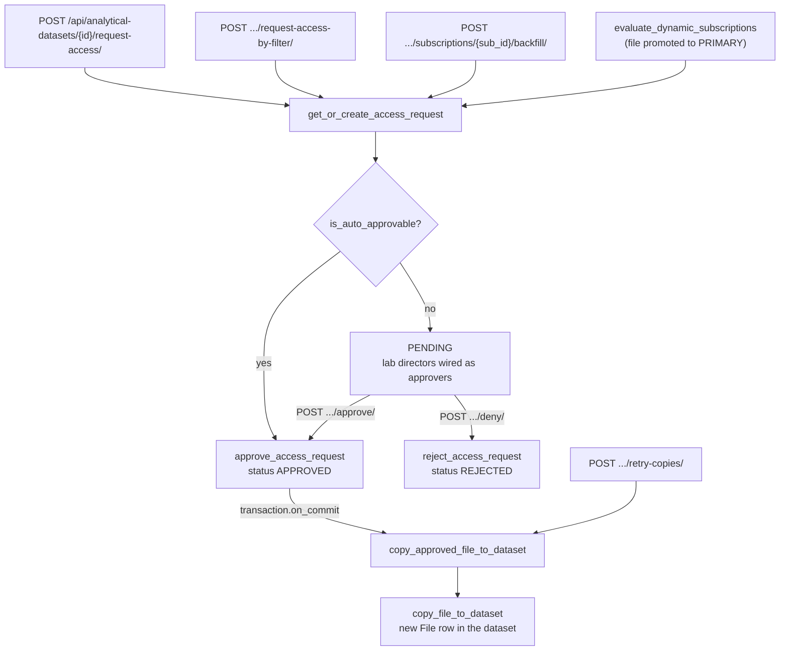

# Analytical Dataset Access Requests

An analytical dataset never holds a sequence directly from a lab bucket. Every file that enters one goes through an `AccessRequest`: one row per requester, dataset and file. The request is either auto-approved on creation or waits for a lab director of the file's lab, and only an approved request is copied into the dataset's bucket. This page walks through that flow end to end.

The `access_requests` app no longer has REST endpoints of its own. The model, rules and notifications live in `asu_apgap/access_requests/` (`models.py`, `services.py`, `signals.py`, `notifications.py`), and every endpoint that touches requests is an action on `AnalyticalDatasetViewSet` in `asu_apgap/analytical_datasets/api/views.py`. The copy runs in `asu_apgap/analytical_datasets/celery_tasks/file_copy.py`.

---

## The `AccessRequest` Model

| Field | Purpose |
|---|---|
| `user` | The requester. |
| `analytical_dataset` | The dataset the file should land in. |
| `file` | The source file. Its lab decides who approves. |
| `status` | `PENDING` (default), `APPROVED` or `REJECTED`. |
| `approvers` | Many to many through `AccessRequestApprover`: the lab directors who can act on it. |
| `denied_by`, `denial_reason` | Set on rejection. |
| `triggering_subscription` | The `DatasetSubscription` that created the request, if any. |

A `UniqueConstraint` on `(user, analytical_dataset, file)` means a requester can only ever have one request per file per dataset. All three foreign keys cascade, so deleting a dataset, file or user removes its requests. The model also carries `created_at` and `updated_at` from `TimeStampedModel`. Requests can be inspected in the Django admin, which registers `AccessRequest` and `AccessRequestApprover`.

---

## `get_or_create_access_request` Is the Only Way Requests Are Created

`asu_apgap/access_requests/services.py` holds three functions:

1. **`get_or_create_access_request(user, dataset, file, ...)`** calls `get_or_create` on the unique triple. If the row already existed it returns it unchanged. On first creation it runs `is_auto_approvable()` and, if true, calls `approve_access_request`. It then attaches every `LabUser` of the file's lab with `is_lab_admin=True` as an approver (`bulk_create` with `ignore_conflicts=True`) and notifies them. The `notify_on_auto_approve` and `notify_approvers` flags let bulk callers turn off the per-file notifications and batch them instead.
2. **`approve_access_request(access_request, actor=None)`** moves a `PENDING` request to `APPROVED` and calls `enqueue_copy_approved_file_to_dataset`. It is a no-op for any other status, so a double approve cannot run the copy twice.
3. **`reject_access_request(access_request, actor, reason)`** moves a `PENDING` request to `REJECTED` and stores `denied_by` and `denial_reason`. It is also a no-op for any other status.

---

## Auto-Approval Rules

`AccessRequest.is_auto_approvable()` in `asu_apgap/access_requests/models.py` returns True when any of these hold:

1. **Organization default.** The requester's organization has `default_approve_analytical_dataset_requests` set, the dataset's lab (through its project) belongs to that same organization, and `file.has_reportable_pathogen()` is True.
2. **Lab Director of the file's lab.** The requester has a `LabUser` on the file's lab whose permission group is Lab Director.
3. **Standing grant.** A `LabAutoApproval` row exists for the file's lab and the requester. Level `ALL_LAB` approves any file in the lab; `OWN_UPLOADS` approves only files whose `created_by` is the requester.

`has_reportable_pathogen` looks at the file's pathogen metadata tags: a tagged pathogen marked `reportable` counts immediately, otherwise each tagged pathogen's reportability rules are checked against the file.

Lab directors manage grants with `POST /api/labs/{id}/auto-approval/` and a body of `{"user_id": ..., "level": "NONE" | "OWN_UPLOADS" | "ALL_LAB"}`. `LabHierarchicalPermission` maps this action to `change_lab`, the lab must be `ACTIVE`, and the target user must be a member of the lab directly or through one of its projects. `NONE` deletes the grant. Removing a user from a lab also deletes their grant unless they still belong to one of the lab's projects.

---

## Four Paths Create Requests

| Path | Requester | Notes |
|---|---|---|
| `POST /api/analytical-datasets/{id}/request-access/` with `{"files": [ids]}` | Caller | Files are taken by ID. |
| `POST /api/analytical-datasets/{id}/request-access-by-filter/` | Caller | Rebuilds the catalog query from `filters` (same keys as `GET /api/files`) over `File.objects.in_catalog(include_archived=False)`, applies `search`, and removes `exclude_file_ids`. |
| `POST /api/analytical-datasets/{id}/subscriptions/{sub_id}/backfill/` | The subscription's `created_by`, falling back to the caller | Adds files the rule matches now, skipping files already in the dataset. Blocked for inactive subscriptions and datasets being deleted. |
| `evaluate_dynamic_subscriptions` Celery task | The matching rule's `created_by` | Runs after a file is promoted to `PRIMARY`. |

The first three share `_create_access_requests`, which splits the files into existing and new, calls `get_or_create_access_request` for each new file with notifications suppressed, and then sends one batched "approved" and one batched "created" notification. The response lists `created` and `existing` requests with their IDs and statuses.

`evaluate_dynamic_subscriptions` (`asu_apgap/analytical_datasets/celery_tasks/dynamic_subscriptions.py`) checks every active subscription and, per dataset whose rules match and that has no copy of the file yet:

- **Same lab** (the file's lab is the dataset's project's lab): it creates the request under the lowest-ID matching rule that still has an owner, approves it even if the auto-approval rules would not, and tells the owner only when the request is new.
- **Cross lab**: it acts only if a matching rule has `allow_cross_lab=True`, and creates the request with the normal rules, so it stays `PENDING` unless the owner is auto-approvable.

**Important:** `POST /api/datasets/{id}/request-access/` in `asu_apgap/datasets/api/views.py` is a different feature. It asks for a sequencing `Dataset` to be used by a project, creates no `AccessRequest`, and only sends an `ACCESS_REQUEST` notification to the Lab Director group members of the dataset's owning lab.

---

## Approving and Denying

Both actions are on `AnalyticalDatasetViewSet` and act on all matching `PENDING` requests of the dataset at once.

**`POST /api/analytical-datasets/{id}/approve/`.** A superuser or Platform Admin group member approves every pending request on the dataset. Anyone else must be `is_lab_admin` on at least one active lab (403 otherwise), and approves only the pending requests whose file is in those labs. Each request goes through `approve_access_request`, then one `notify_requests_approved` call covers them. The response is `{"status": "approved", "approved_count": n}`, or a 200 message when everything is already processed, or a 404 when there are no requests in scope.

**`POST /api/analytical-datasets/{id}/deny/`** with a required `denial_reason`. It rejects the pending requests whose file is in an active lab where the caller is `is_lab_admin`, with the same 403, 200 and 404 responses. It has no separate platform admin branch.

Reaching either action first passes `AnalyticalDatasetPermission`: platform admins and users with access to the dataset's project pass, and a lab director (Lab Director group and `is_lab_admin` on an active lab) without project access passes only while the dataset has a pending request for a file in their lab.

---

## Approved Requests Become File Copies

`enqueue_copy_approved_file_to_dataset` schedules `copy_approved_file_to_dataset` with `transaction.on_commit`, so the worker only sees a committed `APPROVED` row. The task (`max_retries=20`) re-checks state when it runs:

1. Skips if the request is gone or no longer `APPROVED`.
2. Skips if the dataset's `deletion_status` is not `NONE`.
3. Skips if a `File` with `original_file` set to the source already exists in the dataset.
4. Retries every 30 seconds while the dataset has no `gcs_bucket` yet, since the bucket is created by a separate signal.
5. Calls `copy_file_to_dataset`.

`copy_file_to_dataset` in `asu_apgap/analytical_datasets/services.py` copies the blob from the lab bucket to the root of the dataset bucket under the original filename (only when `ENABLE_GCP_INTERACTIONS` is True), then, under a `select_for_update` lock on the dataset, creates a new `File` with `original_file` and `analytical_dataset` set and the source's lab, type, size, status, creator and source type. If a copy row already exists it returns that instead. It bumps the dataset's `updated_at` and queues a metadata CSV refresh.

**Important:** A copy that never lands does not change the request. `AnalyticalDataset.uncopied_approved_requests()` finds `APPROVED` requests with no matching copy, the detail serializer exposes the count as `uncopied_approved_count`, and `POST /api/analytical-datasets/{id}/retry-copies/` re-queues the copy task for each of them. Platform admins and users with access to the dataset's project may call it, since it only re-runs work that was already approved; it returns `{"enqueued_count": n}` and is refused while the dataset is being deleted.

---

## Dataset Status Is Computed, Not Stored

The dataset no longer has an `approval_status` column. `rollup_dataset_status` in `asu_apgap/analytical_datasets/models.py` derives an `ApprovalStatus` from the request statuses the viewer can see:

| Visible request statuses | Dataset status |
|---|---|
| Any `PENDING` | `PENDING` |
| Both `APPROVED` and `REJECTED`, none pending | `PARTIAL` |
| Only `REJECTED` | `DENIED` |
| Only `APPROVED` | `APPROVED` |
| No requests | `PENDING` |

The list serializer reads `status_pending`, `status_approved` and `status_rejected` annotations, and the detail serializer reads the prefetched requests. Both are scoped by `scope_request_q` in `asu_apgap/analytical_datasets/api/filters.py`, so a lab director sees the status of their own lab's slice. The `?scope=mine` and `?scope=approvals` list parameters, and `?status=PENDING|APPROVED|REJECTED`, use the same filter. `has_pending_access_requests` is not scoped and covers the whole dataset.

---

## Approvers Follow Lab Membership

The approver list is written when a request is created. `asu_apgap/access_requests/signals.py` keeps it current: `post_save` and `post_delete` receivers on `LabUser` schedule `resync_lab_director_approvers(lab)` on commit. It locks the lab row, recomputes the `is_lab_admin` members, adds missing approvers to and removes stale approvers from every `PENDING` request on the lab's files, and calls `notify_approvers_assigned` for the additions. Approved and rejected requests are not touched.

---

## Notifications

All of these live in `asu_apgap/access_requests/notifications.py` and pass through `filter_recipients_by_preferences`.

| Function | Type | Recipients | Grouping |
|---|---|---|---|
| `notify_requests_created` | `ACCESS_REQUEST` | Each approver of the pending requests | One per approver, dataset and requester |
| `notify_approvers_assigned` | `ACCESS_REQUEST` | Approvers added by a re-sync | One per approver, dataset and requester; withheld if that approver was already notified about that dataset and requester |
| `notify_requests_approved` | `ACCESS_REQUEST_APPROVED` | Requester | One per requester and dataset |
| `notify_requests_denied` | `ACCESS_REQUEST_DENIED` | Requester, with the reason | One per requester and dataset |

Approver notifications link to `/dashboard/dataset-requests` and requester notifications link to `/dashboard/my-dataset-requests`. Separately, `remind_access_requests` in `asu_apgap/notifications/celery_tasks/reminders.py` sends one `ACCESS_REQUEST` reminder per dataset with pending requests to its approvers, when that reminder type is enabled in `ReminderSettings`. See [Celery Tasks](/core-concepts/backend/celery_tasks/) for the beat schedule.
