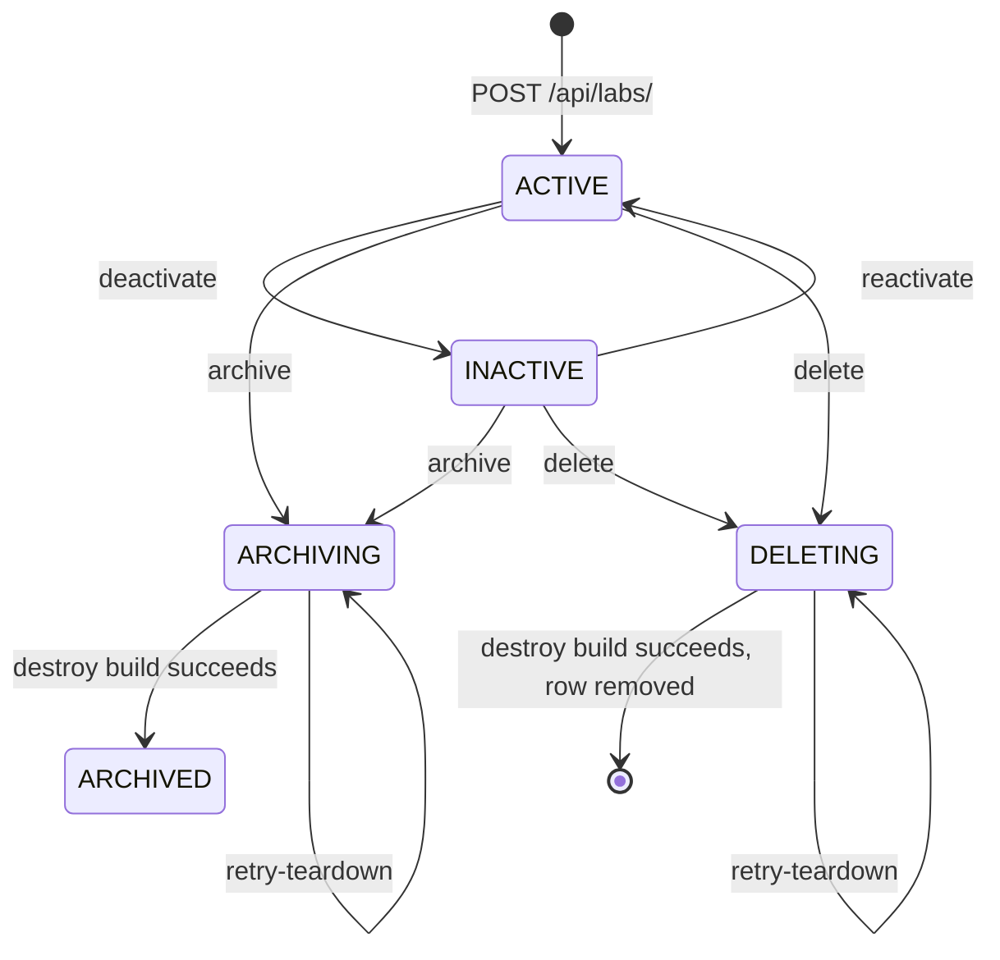

# Lab Lifecycle

A lab is created once, provisioned into its own GCP project by Cloud Build, and from then on moves through a small set of statuses: it can be deactivated and reactivated, archived (its GCP project is torn down but its record is kept), or deleted (its GCP project is torn down and its row is removed). Lab directors cannot archive a lab themselves; they file an archive request that a platform admin approves. This page walks through each step.

Creation lives in `asu_apgap/labs/signals.py` and `asu_apgap/labs/celery_tasks/cloud_build.py`. Every status change after that goes through `asu_apgap/labs/lifecycle.py`, with the teardown poller in `asu_apgap/labs/celery_tasks/teardown.py` and lab archive requests in `asu_apgap/labs/archive_requests.py`.

---

## Creating a Lab Triggers a Cloud Build

`POST /api/labs/` goes through `LabViewSet` with `LabHierarchicalPermission`, which maps `create` to the global `labs.add_lab` permission. `setup_permission_groups` grants it to the Platform Admin and Lab Director groups. `LabPostPatchSerializer.create` requires a `lab_director_id`, rejects a director whose global role cannot be assigned to labs, creates the `Lab` with `created_by` set to the caller, moves any `project_pks` into the lab, and creates a `LabUser` for the director with the Lab Director group and `is_lab_admin=True`.

`Lab.save` fills `project_prefix` from `generate_project_prefix`, which builds `apgap-lab-{identifier}-{rand}` from the display name and a random hex suffix. Three `post_save` receivers then run on creation:

1. **`notify_lab_created`** sends a `LAB_CREATED` notification to the Platform Admin group.
2. **`trigger_gcp_lab_project_creation`** calls `trigger_cloud_build` with `CLOUD_BUILD_GCP_LAB_PROJECT_CREATION_TRIGGER_ID` and the substitutions `_LAB_NAME` (the project prefix) and `_BILLING_ACCOUNT_ID` (from `lab_billing_account_substitution`).
3. **`sync_lab_to_sequencing_lab_metadata`** adds the lab's name as an option on the sequencing lab metadata template.

When the trigger call raises, the error is saved to `last_build_error` (only if `ENABLE_CLOUD_BUILD_TRIGGER` is True) and the exception propagates, so the create request fails. When it returns nothing while the flag is on, the error is captured and an exception is raised. When a build ID comes back, `last_build_error` is cleared and `poll_lab_cloud_build_status` is queued.

**Important:** `CloudBuildClient.trigger_build` returns `None` without calling GCP when `ENABLE_CLOUD_BUILD_TRIGGER` is False. The signal treats that as a no-op, so locally a lab is created with `build_status` left empty and no poller runs.

---

## `poll_lab_cloud_build_status` Records the Build Result

The poller is a bound task with `max_retries=24` that calls `self.retry(countdown=60)` until the build is terminal. It takes a Redis lock, `cloud_build_poll_lock:<build_id>`, with a 65 second TTL so only one worker polls a given build at a time.

On every check it writes the Cloud Build status to `Lab.build_status` (`QUEUED`, `WORKING`, `SUCCESS`, `FAILURE`, `TIMEOUT` or `CANCELLED`). Once the status is terminal:

| Result | What happens |
|---|---|
| `SUCCESS` | `last_build_error` is cleared, `set_gcs_bucket` reads `lab_sequences_bucket_name` from the lab's Terraform state, and `populate_terraform_cache` caches the GCP project ID and billing account. |
| `FAILURE`, `TIMEOUT` or `CANCELLED` | `capture_build_error` stores a message with the status and build ID on `last_build_error`. |

Any other exception during a poll is also captured on `last_build_error` and the task retries. `GET /api/labs/{id}/build-log/` returns the stored `last_build_error`, and `LabSerializer` exposes `has_build_error`.

---

## `LabStatus` Has Five Values

`Lab.status` is a `LabStatus` choice. The separate `active` boolean is what the rest of the codebase filters on (`lab__active=True`), and the lifecycle keeps the two in step.

| Status | `active` | Meaning |
|---|---|---|
| `ACTIVE` | True | Normal operation. |
| `INACTIVE` | True | Read only. Its sequences stay but leave the Data Catalogue. |
| `ARCHIVING` | False | Destroy build is running for an archive. |
| `ARCHIVED` | False | GCP project torn down, record kept. |
| `DELETING` | False | Destroy build is running for a delete. The row is removed when it succeeds. |

`assert_lab_active` in `asu_apgap/labs/api/guards.py` raises a 400 for every status except `ACTIVE`. Write paths such as lab edits, assigning and removing users, and setting auto-approval call it. Lifecycle actions do not.

Inactive labs are left out of the catalogue: `File.objects.in_catalog` and the `catalog` filter on `FileFilter` exclude `lab__status=INACTIVE`. Archiving and deleting labs drop out everywhere `lab__active=True` is used. Platform admins still reach them by ID, and see them in the lab list with `?include_archived=true`.

---

## Each Transition Is Checked Twice

`lifecycle_checks(lab)` returns an `ActionCheck` (`allowed` and `reason`) for every action, and `LabSerializer.lifecycle` exposes that to platform admins so the UI can disable buttons with a reason. Each transition then locks the lab row with `select_for_update` and runs the same check again, raising `LabLifecycleError` (a 400 from the API) if it no longer holds.

| Action | Allowed when |
|---|---|
| `deactivate` | Status `ACTIVE`, `build_status` `SUCCESS`, and every project is `ARCHIVED`. |
| `reactivate` | Status `INACTIVE`. |
| `archive` | Status `ACTIVE` or `INACTIVE`, `build_status` `SUCCESS`, every project `ARCHIVED`, and every file `ARCHIVED` or `DELETED`. |
| `delete` | Status `ACTIVE` or `INACTIVE`, the provisioning build is not `QUEUED` or `WORKING`, no projects at all (archived ones count), and every file `DELETED`. |
| `retry_teardown` | Status `ARCHIVING` or `DELETING`. |

Deactivating also revokes the lab's batch upload endpoints after commit through `deactivate_lab_batch_uploads`.

---

## Archive and Delete Run a Destroy Build

`archive(lab, user, note)` stores `archived_at`, `archived_by` and `archive_note`, then calls `_begin_teardown` with `ARCHIVING`. `delete(lab, user)` calls `_begin_teardown` with `DELETING`. `_begin_teardown` sets the status, sets `active=False`, clears `teardown_build_id` and `last_build_error`, and schedules `start_teardown` with `transaction.on_commit` so GCP is only touched after the status change commits.

`start_teardown`:

1. **Revokes batch uploads.** Their secrets and service account keys live outside the lab's GCP project, so the destroy build would leave them behind.
2. **Short-circuits when nothing was provisioned.** If `ENABLE_CLOUD_BUILD_TRIGGER` is False or the lab has no `project_prefix`, it calls `finalize_teardown` directly.
3. **Requires the destroy trigger.** If `CLOUD_BUILD_GCP_LAB_PROJECT_DESTROY_TRIGGER_ID` is empty, the teardown is recorded as failed.
4. **Triggers the destroy build** with the same `_LAB_NAME` and `_BILLING_ACCOUNT_ID` substitutions, saves the build ID on `teardown_build_id`, and queues `poll_lab_teardown_build`.

`poll_lab_teardown_build` checks the build every 60 seconds for up to 60 retries, about an hour. It exits quietly if the lab has left the teardown statuses or `teardown_build_id` no longer matches (a retry started a newer build). A successful build calls `finalize_teardown`; a failed build, or running out of retries, calls `record_teardown_failure`.

`finalize_teardown` locks the lab and is safe to call twice:

- **Archive:** status becomes `ARCHIVED`, `last_build_error` is cleared, and a `LAB_ARCHIVED` notification is sent after commit.
- **Delete:** it collects the recipients, removes the lab's option from the sequencing lab metadata template (unless another lab has the same name), deletes the `Lab` row, and sends `LAB_DELETED` after commit.

`record_teardown_failure` leaves the lab in `ARCHIVING` or `DELETING`, captures the error on `last_build_error`, and sends an `error` status `LAB_ARCHIVED` or `LAB_DELETED` notification to platform admins that links to the lab page.

**Important:** A failed teardown never moves the lab forward. `POST /api/labs/{id}/retry-teardown/` clears the error and runs `_resume_teardown`, which reads the existing `teardown_build_id`: if that build is still running it resumes polling, if it succeeded it finalizes, and otherwise it starts a new destroy build.

---

## What Happens to Related Records

On **archive**, the `Lab` row stays, so its `LabUser` memberships, `LabAutoApproval` grants, archived projects and archived or deleted files stay too. They are hidden because `active` is False.

On **delete**, `Project.lab`, `File.lab`, `LabUser.lab` and `LabAutoApproval.lab` all use `on_delete=CASCADE`, so whatever rows remain go with the lab. The delete check already guarantees there are no projects and that every file is `DELETED`. User accounts are not deleted; only their membership rows are.

Projects are archived separately, before the lab, with `POST /api/projects/{id}/archive/` (`CanArchiveProject`, which needs `projects.archive_project`). `ProjectArchiveService.archive_project` in `asu_apgap/projects/services.py` sets the project to `ARCHIVED`; its `post_save` handler then runs `process_archiving_behavior`, which deletes the project's analytical datasets and starts cleanup of the project's GCP resources and Seqera workspace. Platform admins can instead remove a project with `POST /api/projects/{id}/hard-delete/` (`ProjectDeletionService.hard_delete_project`), which requires a justification of at least 10 characters.

---

## Lab Directors Request an Archive, Platform Admins Approve It

A lab archive request is an `ArchiveRequest` (`asu_apgap/deletions/models.py`) whose generic foreign key points at the `Lab`. It has the statuses `PENDING`, `APPROVED` and `DENIED`.

1. **Request.** `POST /api/labs/{id}/request-archive/` with a `justification` of at least 20 characters. `CanRequestLabArchive` limits it to Lab Directors of that lab. `archive_requests.request_archive` locks the lab, runs `check_archive`, rejects a second pending request, and creates the `ArchiveRequest`.
2. **Review.** Approve and deny go through the shared archive request endpoints, `POST /api/deletions/archive-requests/{id}/approve/` and `.../deny/`. `ArchiveRequestPermission` lets only platform admins approve or deny a lab request. The requester may retrieve it and may update or delete it while it is `PENDING`.
3. **Approve.** `archive_requests.approve` calls `lifecycle.archive` with the reviewer as the actor and the note `"<justification> (Requested by <name>.)"`, then marks the request `APPROVED`. If the lab can no longer be archived, the endpoint answers 400 and the request stays `PENDING`.
4. **Deny.** The view sets `DENIED` with the `denial_reason`, `reviewed_by` and `reviewed_at`.

`LabSerializer.archive_request`, shown to platform admins and the lab's directors on the lab detail page, returns `request_info`: the four archive requirements from `archive_requirements`, a fifth "no pending request" requirement, `can_request`, and a summary of any pending request.

---

## Lifecycle Endpoints and Permissions

All are actions on `LabViewSet` in `asu_apgap/labs/api/views.py`. See [API Endpoints](/core-concepts/backend/api_endpoints/) for the full list.

| Endpoint | Permission | Success |
|---|---|---|
| `POST /api/labs/{id}/deactivate/` | `CanManageLabLifecycle` (platform admin) | 200 |
| `POST /api/labs/{id}/reactivate/` | `CanManageLabLifecycle` | 200 |
| `POST /api/labs/{id}/archive/` with `archive_note` (20 or more characters) | `CanManageLabLifecycle` | 202 |
| `POST /api/labs/{id}/delete/` | `CanManageLabLifecycle` | 202 |
| `POST /api/labs/{id}/retry-teardown/` | `CanManageLabLifecycle` | 202 |
| `POST /api/labs/{id}/request-archive/` with `justification` (20 or more characters) | `CanRequestLabArchive` (Lab Director of the lab) | 201 |

---

## Notifications

| Type | When | Recipients |
|---|---|---|
| `LAB_CREATED` | Lab row created | Platform Admin group |
| `ARCHIVE_REQUEST` | Lab archive request created | Platform Admin group |
| `ARCHIVE_REQUEST` | Lab archive request approved or denied | The requester |
| `LAB_ARCHIVED` | Archive teardown finished | Platform admins plus the lab's directors (`is_lab_admin` or the Lab Director group) |
| `LAB_DELETED` | Delete teardown finished | The same set, collected before the row is removed |
| `LAB_ARCHIVED` or `LAB_DELETED` with `error` status | Teardown failed | Platform admins |

Every lifecycle notification passes through `filter_recipients_by_preferences`. The archive request notifications come from `asu_apgap/deletions/signals.py`; approval and denial use the `ACCESS_REQUEST_APPROVED` and `ACCESS_REQUEST_DENIED` preferences to pick email recipients.

---

## Settings

| Setting | Default | Purpose |
|---|---|---|
| `ENABLE_CLOUD_BUILD_TRIGGER` | `False` (`base.py`) | When False, no provisioning or destroy builds run, and teardown finalizes immediately. |
| `ENABLE_GCP_INTERACTIONS` | `False` (`base.py`) | When False, `Lab.project_id` returns `dummy-lab-gcp-project-id` and `billing_account` falls back to `billing_account_id` or a dummy value instead of reading Terraform state. |
| `CLOUD_BUILD_GCP_PROJECT_ID` | `""` | Project that owns the Cloud Build triggers. |
| `CLOUD_BUILD_GCP_LOCATION` | `""` | Trigger region. |
| `CLOUD_BUILD_GCP_LAB_PROJECT_CREATION_TRIGGER_ID` | `""` | Trigger that provisions a lab project. |
| `CLOUD_BUILD_GCP_LAB_PROJECT_DESTROY_TRIGGER_ID` | `""` | Trigger that destroys a lab project. Teardown fails if it is empty while builds are enabled. |
| `LAB_BILLING_ACCOUNT_ID` | `""` | Billing account used when `Lab.billing_account_id` is empty. |

The `CLOUD_BUILD_*` settings are defined in `config/settings/local.py`, `production.py` and `test.py` rather than `base.py`; the defaults shown are the `local.py` and `production.py` ones. `local.py` and `test.py` set both feature flags to False. Locally, a new lab never gets `build_status` `SUCCESS`, so `deactivate` and `archive` stay blocked until you set it yourself, while `delete` of an empty lab finalizes straight away.
